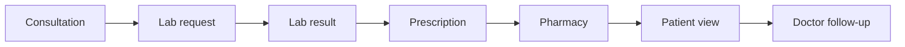
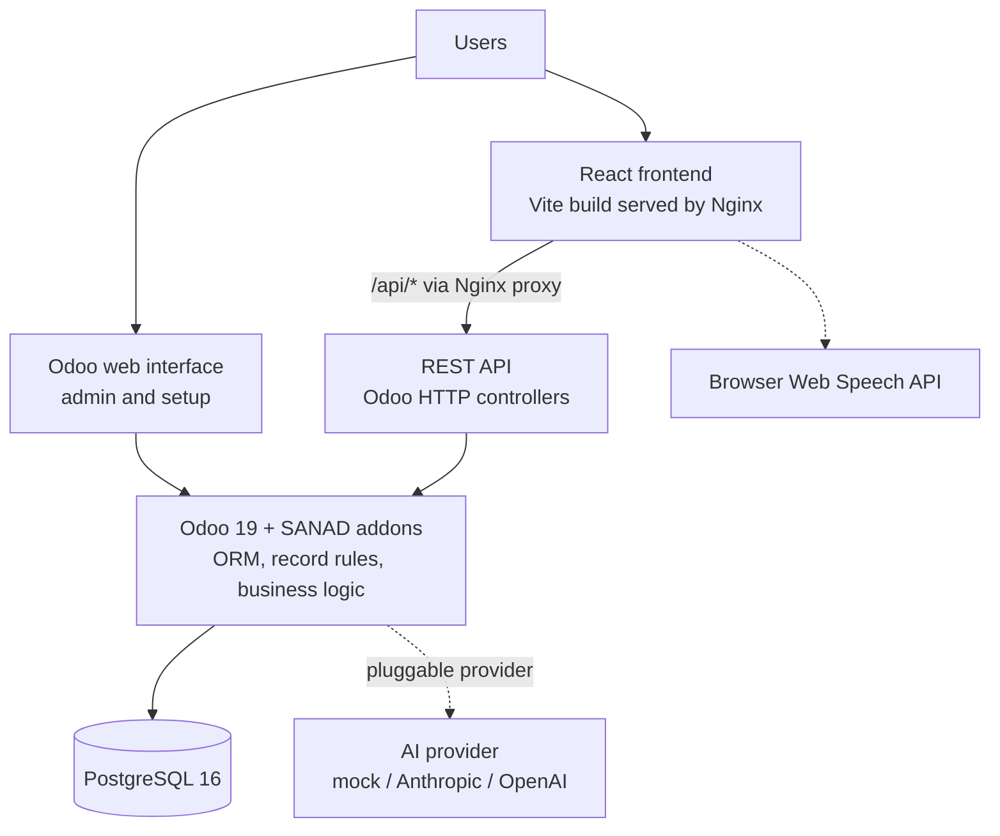
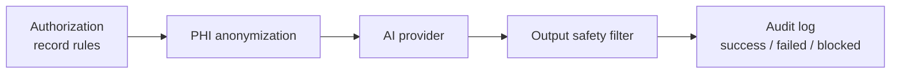

[README.md](https://github.com/user-attachments/files/34202008/README.md)
# SANAD Healthcare Platform

A healthcare management platform **prototype** that connects doctors, patients, laboratories and pharmacies around one shared, access-controlled patient record.

Built with **Odoo 19** (backend), **React** (frontend), **PostgreSQL**, **Docker** and **Nginx**, with an AI assistant that explains and translates existing medical information.

> **Disclaimer:** SANAD is a development project, not a certified medical product. It does not diagnose, prescribe or replace a healthcare professional, and it has not been audited for real clinical use. Do not load real patient data into it.

Developed as a freelance development project.

<!--
Uncomment once you have added your screenshots to docs/screenshots/

## Screenshots

| Doctor dashboard | Lab results with KPI trend | AI assistant |
|---|---|---|
|  |  |  |
-->

---

## The problem

In small healthcare setups, the consultation, the lab analysis and the pharmacy order usually live in separate systems, paper files or phone calls. The patient ends up carrying the information from one place to the next, and nobody has a clear view of the full history.

## The idea

One platform where each role sees exactly what it is authorized to see, across the whole patient journey:



---

## Roles

| Role | What they do in SANAD |
|---|---|
| **Administrator** | Sets up users, roles and organizations (cabinets, laboratories, pharmacies), configures the AI provider, reads the AI audit log |
| **Doctor** | Views assigned patients, records consultations, writes prescriptions, sends lab requests, follows lab trends, chats |
| **Patient** | Views their own record, prescriptions and lab results (with trend charts), chats with their doctor, uses the AI assistant |
| **Laboratory** | Sees requests routed to its own lab, moves them through the workflow, uploads results |
| **Pharmacy** | Sees prescriptions routed to its own pharmacy, moves them through the fulfillment workflow |

A user can hold several roles at once. Roles are independent groups, not a hierarchy.

---

## Architecture



**Why Odoo 19:** it provides the ORM, the permission engine, user management, an admin interface and a mail/messaging layer, so the project work could focus on the healthcare-specific models, rules and workflows.

**How the frontend talks to the backend:** the React app calls REST endpoints implemented as Odoo HTTP controllers (`type='jsonrpc'`, `auth='user'`). Authentication is Odoo's own session cookie. Because the endpoints run as the logged-in user, Odoo's record rules apply automatically and permission logic is not duplicated in the controllers.

**Deployment shape:** three Docker containers (PostgreSQL, Odoo, Nginx serving the built frontend). Nginx proxies `/api/` to Odoo, so the browser sees a single origin.

### Odoo modules

| Module | Responsibility |
|---|---|
| `sanad_core` | Security groups, doctors, medical cabinets, laboratory and pharmacy organizations, specialties, AI audit log, auth endpoints |
| `sanad_patient` | Patient profile and the patient–doctor care relationship |
| `sanad_medical` | Medical record, consultations, prescriptions |
| `sanad_laboratory` | Lab requests (status workflow), lab results, KPI evolution |
| `sanad_pharmacy` | Prescription fulfillment workflow |
| `sanad_chat` | Secure conversations built on `mail.thread` |
| `sanad_ai` | AI assistant: anonymization, safety filter, provider registry |

Install order follows the dependency chain: `sanad_core` → `sanad_patient` → `sanad_medical` → `sanad_laboratory` / `sanad_pharmacy` / `sanad_chat` → `sanad_ai`.

### REST API (34 endpoints)

| Area | Examples |
|---|---|
| Auth | `/api/auth/login`, `/api/auth/logout`, `/api/auth/session` |
| Patients | `/api/patients`, `/api/patients/me`, `/api/care-relationships` |
| Medical | `/api/medical-records/<patient_id>`, `/api/consultations`, `/api/prescriptions` |
| Laboratory | `/api/lab-requests`, `/api/lab-requests/<id>/action`, `/api/lab-results`, `/api/lab-results/kpi` |
| Pharmacy | `/api/pharmacy/prescriptions`, `/api/pharmacy/prescriptions/<id>/action` |
| Chat | `/api/chat/conversations`, `/api/chat/conversations/<id>/messages`, `/api/chat/poll` |
| AI | `/api/ai/search`, `/api/ai/explain`, `/api/ai/translate`, `/api/ai/tts` |

---

## Security and access control

- **Care relationship gate.** A doctor can only access a patient if an active `sanad.patient.doctor.rel` record links them. This is enforced twice: by Odoo record rules (what a query can return) and by `@api.constrains` checks on consultations, prescriptions and lab requests (what can be created).
- **Organization scoping.** Laboratory and pharmacy staff only see requests and prescriptions routed to their own organization.
- **Field-level restriction for pharmacy.** The pharmacy API serializer only returns medication, dosage, frequency, duration and instructions, never clinical notes.
- **Chat rules.** Only doctor–patient, doctor–laboratory and doctor–pharmacy pairings are allowed, validated server-side. A doctor–patient chat also requires an active care relationship.
- **Audit trail for AI.** No security group can write to `sanad.ai.log`; entries are created server-side only.

---

## AI assistant

The assistant explains, searches, translates and reads aloud information the user is already authorized to see. It is not designed to diagnose or recommend treatment.

Every request goes through the same pipeline in `sanad_ai`:



1. **Authorization:** the target record is fetched under the caller's access rights. If it is not visible, the request is blocked before any AI call.
2. **Anonymization:** known identifiers (names, phone, email, address, license number) are replaced with placeholders, then a regex pass catches emails, dates, phone numbers and ID-like strings.
3. **Provider call:** the provider is selected from system parameters (`sanad_ai.provider`, `sanad_ai.api_key`, `sanad_ai.model`).
4. **Safety filter:** responses containing diagnostic or prescriptive language are blocked, and an educational disclaimer is appended to allowed responses.
5. **Audit log:** each attempt is written to `sanad.ai.log`.

**Providers implemented:** `mock` (default, offline, no external call), `anthropic`, `openai`. Adding another provider means one class plus one entry in `PROVIDER_REGISTRY`. If a real provider is selected but no API key is set, the code falls back to the mock provider.

**Text-to-speech** uses the browser's Web Speech API. No server-side speech generation is implemented.

---

## Tech stack

| Layer | Technology |
|---|---|
| Backend | Odoo 19, Python |
| Database | PostgreSQL 16 |
| Frontend | React 18, Vite, React Router, Axios, Recharts |
| Infrastructure | Docker Compose, Nginx |
| AI | Pluggable provider layer (mock, Anthropic, OpenAI), plain `requests` calls |

---

## Getting started

### Prerequisites

- Docker and Docker Compose
- Node.js 20+ (only for running the frontend outside Docker)

### 1. Configure

```bash
cp .env.example .env
# set POSTGRES_PASSWORD in .env
```

The Odoo master password (`admin_passwd`) is **not** read from `.env`. Set it directly in `docker/odoo.conf` before any shared or production use.

### 2. Start the stack

```bash
cd docker
docker compose --env-file ../.env up -d
```

- Odoo backend: http://localhost:8069
- React frontend: http://localhost:3000

### 3. Create the database and install the modules

```bash
docker exec -it sanad_odoo odoo -d sanad_db -i sanad_core,sanad_patient,sanad_medical,sanad_laboratory,sanad_pharmacy,sanad_chat,sanad_ai --stop-after-init
docker compose restart odoo
```

Add `--without-demo=False` to load the demo data. Leave it out for a clean database.

### 4. Set passwords for the demo accounts

Demo users are created without a password. Set your own through the Odoo shell:

```bash
docker exec -it sanad_odoo odoo shell -d sanad_db
```

```python
env['res.users'].search([('login', '=', 'doctor.demo@sanad-health.example.com')]).write({'password': '<choose-a-password>'})
env['res.users'].search([('login', '=', 'patient.demo@sanad-health.example.com')]).write({'password': '<choose-a-password>'})
env.cr.commit()
```

### 5. Log in

Open http://localhost:3000 and sign in with the Odoo login (email) and password of any user. The frontend uses Odoo's own authentication, so there is no separate SANAD account system.

> **Tip:** the frontend and the Odoo backend share the `localhost` cookie jar (cookies are not port-specific). Logging in to http://localhost:8069 as another user in the same browser can replace the session used by the frontend. Use separate browser profiles or private windows per role when testing.

### Frontend development without Docker

```bash
cd frontend
npm install
npm run dev     # http://localhost:3000, proxies /api to http://localhost:8069
```

---

## Project structure

```
sanad/
├── custom-addons/        # 7 Odoo modules (models, security, views, controllers, tests)
├── frontend/             # React + Vite application
├── docker/               # docker-compose.yml, odoo.conf, nginx.conf, Dockerfile.frontend
├── scripts/              # check_xmlid_order.py (static external-ID load-order checker)
├── .env.example
└── README.md
```

---

## Testing

The repository includes 18 Odoo `TransactionCase` test files covering RBAC and care-relationship access, consultation/prescription constraints, the lab and pharmacy workflows, chat pairing rules, PHI anonymization, the AI safety filter, AI authorization and audit logging, and one end-to-end patient journey.

```bash
docker exec -it sanad_odoo odoo -d sanad_db --test-enable --stop-after-init \
  -i sanad_core,sanad_patient,sanad_medical,sanad_laboratory,sanad_pharmacy,sanad_chat,sanad_ai
```

Run a subset by tag (`sanad_rbac`, `sanad_core`, `sanad_medical`, `sanad_laboratory`, `sanad_pharmacy`, `sanad_chat`, `sanad_ai`, `sanad_e2e`):

```bash
docker exec -it sanad_odoo odoo -d sanad_db --test-enable --test-tags sanad_rbac --stop-after-init
```

Static checks:

```bash
python scripts/check_xmlid_order.py     # detects XML external-ID forward references
cd frontend && npm run build            # frontend build
```

---
